# Who decides what

> This is the **default** flow. Everyone can customize their own flow as they wish: pick a per-task template with the label `ah-flow:<full|no_plan|no_dev|quick>`, set a company flow at `/jira setup`, or design your own custom flow (`/flow edit`).

Colours: 🟧 orange = **human decides** · 🟦 blue = **AI model** · 🟩 green = **script / automatic**. ◆ = gate.

```mermaid
flowchart LR
  TD[To Do]:::human -->|HUMAN drags| IP[In Progress]:::script
  IP --> PW["Product Work<br/>AI: BA/PO analysis → plan or question"]:::ai
  PW -->|question| BQ[BA Question]:::ai
  BQ -->|HUMAN answers by comment| PW
  PW -->|plan| PL{{"Planned ◆ gate"}}:::human
  PL -->|HUMAN comments → plan revised, stays Planned| PL
  PL -->|"HUMAN approves (drag or /approve)"| PC["Pre Coding<br/>AI: tech plan + picks developer"]:::ai
  PC --> CO["Coding<br/>AI: assigned developer on feature/&lt;KEY&gt;"]:::ai
  CO --> QC["QC<br/>script: tests/lint/build vs baseline"]:::script
  QC -->|new failure → one fix| CO
  QC -->|pass| PR["branch / PR / merge<br/>script, only if auto-PR ON"]:::script
  PR --> IR{{"In Review ◆ gate"}}:::human
  IR -->|HUMAN review comment → same developer| CO
  IR -->|HUMAN drags| DN[Done]:::human
  DN --> LH["Learn user habits from comments<br/>script + 1 cheap call"]:::script
  classDef human fill:#e7a15a,stroke:#a8692c,color:#1b1206
  classDef ai fill:#6db3f2,stroke:#2f75b5,color:#06121f
  classDef script fill:#c6f26d,stroke:#7fa93a,color:#10210c
```

**Other human decisions**
- Task workflow type: label `ah-flow:<full|no_plan|no_dev|quick>`.
- Company flow at `/jira setup`.
- Auto-PR on/off (`/company set auto-pr on|off`).
- Which repo, when one board feeds several repos: label `repo:<name>`.
- Staff-created tasks (`/task add`, `/task split`) stay in To Do until a human drags them.

**How staff are chosen and what they load**

*`/ceo` (the CEO is always your current chat session)*
- **Route scoring.** The server scores every roster staff against the request text (and file paths, if any) using the routing rules: keyword, group, and path matches. You get a ranked list of candidates, each with its **reasons**.
- **Confidence.** The CEO picks a staff only when it is sure: the top score is at least 2 and no one ties with it. Then `/ceo` names the staff and the reason.
- **Ask, don't guess.** When it is not sure, `/ceo` asks you "Not sure who should take this: A (reason) / B (reason). Which staff?" and waits. It never quietly falls back to the CEO.
- **Scoped loading.** `get_role` returns only the acting staff's card and skills. `get_skill` requires `role` and refuses skills that belong to another staff. `any_role=true` is the explicit override.
- **Caps.** Each staff call loads a condensed **brief** (`staff_brief`): the persona, cut to 1,200 characters or fewer, plus the 2 most relevant of the staff's own skills (3 at most), each summarised. The whole brief stays at or below 6,000 characters (about 1.5k tokens).
- **Runs on that staff's provider.** The CEO is the chat session you are in (no binding). It delegates with `holding staff run <staff> "<task>"` (the default AI agent CLI `/staff run`), which starts the staff as a separate process on its own provider/model/effort (`holding staff set`, `holding provider set`, or the step in `holding project add` / `holding staff add`, where Enter accepts your remembered default from `holding provider list`). Unbound staff use the company default and show `⚠ unbound` in `/staff list`. See docs/PROVIDERS.md.

*Jira flow (listener)*
- **One stage-owner table** (server `STAGE_OWNERS`, cached locally):
  - Product Work / BA Question → BA (or PO)
  - Planned → PO
  - Pre Coding → Tech Lead
  - Coding → the picked developer
  - QC → QC
  - In Review → the same developer

  The server and the lean runner both read this table, so they never disagree.
- **Who starts the work.** When you drag a card to In Progress, the server routes it the same way `/ceo` does:
  - Confident → assigned.
  - Only one developer on the roster → that developer takes it.
  - Otherwise the CEO comments on the card asking who should take it, and the task waits until you reply with a staff name. The reason is shown in the `Started` comment ("Why <staff>: …").
- **Developer pick at Pre Coding.** The Tech Lead's tech plan names a developer from the roster's dev roles (with their skills). A script then checks that the developer is really on the roster; if not, the routed or fallback developer is used.
- **What a lean run loads.** Each stage call gets the same brief as `/ceo` (persona + 2–3 relevant skill summaries, capped at ~1.5k tokens). The brief goes first in the plan, tech-plan and code prompts. `AH_BRIEF=0` turns it off.
- **Staff label.** The card carries `staff:<id>`. It is replaced at each stage and removed at Done. `holding jira list` and the board show it.
- **Gates and To Do.**
  - Entering **Planned** or **In Review** posts a one-time how-to comment: approve or revise, request changes or Done.
  - A comment while the card is in **To Do** gets one reply ("not started yet — drag to In Progress"). Later comments are ignored, so there are no loops.
- **Provider / model / effort per staff.** Set per company with `holding staff set <staff> <provider> <model> [effort]`. Precedence:
  1. `AH_AGENT`, `AH_MODEL` and `AH_EFFORT` env vars
  2. the company staff mapping
  3. global `~/.config/agents-holding/agents.json`
  4. the flow's per-stage model
  5. company defaults
  6. built-in defaults

  `/staff list` shows the result as `<staff> - <model> - <effort>`. See [PROVIDERS.md](PROVIDERS.md).
- **Language.** Output follows the input: the card's title and description, or the latest user comment for replies, or the `/ceo` prompt. A Vietnamese card gets Vietnamese plans, questions, comments and gate hints; a Chinese card gets Chinese. Code, identifiers and commit messages follow the repo's conventions. The `[agent-holding] [<staff>]` prefix never changes. Fixed strings are translated for en/vi/zh/ja/ko; other languages fall back to English. Override per company with `holding company set lang <code|auto>`.

**Which company.** Holding data is per company. Every command takes `--company X`; otherwise the company comes from the nearest `.agents/company.json` above the current folder, then the active company (`holding company use <company>`, stored in `~/.config/agents-holding/active`). `holding company list` lists local companies (repos, boards, bound staff, active marker); `holding status` and `/key show` show the current one. the default AI agent CLI slash commands resolve the same way.

## One /ceo, two modes

`/ceo` routes on its own. If one company resolves (`--company`, `@slug`, the company named in the prompt, the repo `.agents/company.json`, or the active company), it runs in company mode and the reply starts with `[ceo @ <slug>]`. Otherwise, or when the request spans companies, it runs in holding mode and the reply starts with `[holding]`. `/ceo` is an alias.
