# Who decides what

> This is the **default** flow. Everyone can customize their own flow as they wish: pick a per-task template with the label `ah-flow:<full|no_plan|no_dev|quick>`, set a company flow at `/connect-jira`, or design your own custom flow (`/flow edit`).

Colours: 🟧 orange = **human decides** · 🟦 blue = **AI model** · 🟩 green = **script / automatic**. ◆ = gate.

```mermaid
flowchart LR
  TD[To Do]:::human -->|HUMAN drags| IP[In Progress]:::script
  IP --> PW["Product Work<br/>AI: BA/PO analysis → plan or question"]:::ai
  PW -->|question| BQ[BA Question]:::ai
  BQ -->|HUMAN answers by comment| PW
  PW -->|plan| PL{{"Planned ◆ gate"}}:::human
  PL -->|HUMAN comments → plan revised, stays Planned| PL
  PL -->|"HUMAN approves (drag or /approve)"| PC["Pre Coding<br/>AI: tech plan + picks developer"]:::ai
  PC --> CO["Coding<br/>AI: assigned developer on feature/&lt;KEY&gt;"]:::ai
  CO --> QC["QC<br/>script: tests/lint/build vs baseline"]:::script
  QC -->|new failure → one fix| CO
  QC -->|pass| PR["branch / PR / merge<br/>script, only if auto-PR ON"]:::script
  PR --> IR{{"In Review ◆ gate"}}:::human
  IR -->|HUMAN review comment → same developer| CO
  IR -->|HUMAN drags| DN[Done]:::human
  DN --> LH["Learn user habits from comments<br/>script + 1 cheap call"]:::script
  classDef human fill:#e7a15a,stroke:#a8692c,color:#1b1206
  classDef ai fill:#6db3f2,stroke:#2f75b5,color:#06121f
  classDef script fill:#c6f26d,stroke:#7fa93a,color:#10210c
```

**Other human decisions**
- Task workflow type: label `ah-flow:<full|no_plan|no_dev|quick>`.
- Company flow at `/connect-jira`.
- Auto-PR on/off (`/auto-pr on|off`).
- Which repo, when one board feeds several repos: label `repo:<name>`.
- Staff-created tasks (`/new-task`, `/split`) stay in To Do until a human drags them.

**How staff are chosen**
- Stage owner by a fixed table: BA/PO (Product Work), Tech Lead (Pre Coding), QC.
- Developer: picked by the AI at Pre Coding from roster skills, then validated by script.
- `/ceo` suggests an owner by rule scoring.
