# Wer entscheidet was

[English](../WHO-DECIDES.md)

> Das ist der **Standard**-Flow. Jeder kann ihn anpassen: pro Aufgabe ein Template mit dem Label `ah-flow:<full|no_plan|no_dev|quick>` wählen, den Firmen-Flow unter `/jira setup` setzen oder einen eigenen Flow entwerfen (`/flow edit`).

Farben: 🟧 orange = **Mensch entscheidet** · 🟦 blau = **KI-Modell** · 🟩 grün = **Skript / automatisch**. ◆ = Tor.

```mermaid
flowchart LR
  TD[To Do]:::human -->|HUMAN drags| IP[In Progress]:::script
  IP --> PW["Product Work<br/>AI: BA/PO analysis → plan or question"]:::ai
  PW -->|question| BQ[BA Question]:::ai
  BQ -->|HUMAN answers by comment| PW
  PW -->|plan| PL{{"Planned ◆ gate"}}:::human
  PL -->|HUMAN comments → plan revised, stays Planned| PL
  PL -->|"HUMAN approves (drag or /approve)"| PC["Pre Coding<br/>AI: tech plan + picks developer"]:::ai
  PC --> CO["Coding<br/>AI: assigned developer on feature/&lt;KEY&gt;"]:::ai
  CO --> QC["QC<br/>script: tests/lint/build vs baseline"]:::script
  QC -->|new failure → one fix| CO
  QC -->|pass| PR["branch / PR / merge<br/>script, only if auto-PR ON"]:::script
  PR --> IR{{"In Review ◆ gate"}}:::human
  IR -->|HUMAN review comment → same developer| CO
  IR -->|HUMAN drags| DN[Done]:::human
  DN --> LH["Learn user habits from comments<br/>script + 1 cheap call"]:::script
  classDef human fill:#e7a15a,stroke:#a8692c,color:#1b1206
  classDef ai fill:#6db3f2,stroke:#2f75b5,color:#06121f
  classDef script fill:#c6f26d,stroke:#7fa93a,color:#10210c
```

**Weitere menschliche Entscheidungen**
- Workflow-Typ der Aufgabe: Label `ah-flow:<full|no_plan|no_dev|quick>`.
- Firmen-Flow unter `/jira setup`.
- Auto-PR an/aus (`/company set auto-pr on|off`).
- Welches Repo, wenn ein Board mehrere Repos speist: Label `repo:<name>`.
- Vom Staff erstellte Aufgaben (`/task add`, `/task split`) bleiben in To Do, bis ein Mensch sie zieht.

**Wie Staff gewählt wird und was geladen wird**

*`/ceo` (der CEO ist immer deine aktuelle Chat-Sitzung)*
- **Routing-Score.** Der Server bewertet jeden Roster-Staff gegen den Anfragetext (und Dateipfade, falls vorhanden) mit den Routing-Regeln: Keyword-, Gruppen- und Pfadtreffer. Du bekommst eine Rangliste mit **Begründungen**.
- **Konfidenz.** Der CEO wählt nur, wenn er sicher ist: Top-Score mindestens 2 und kein Gleichstand. Dann nennt `/ceo` den Staff und den Grund.
- **Fragen, nicht raten.** Wenn unsicher, fragt `/ceo` „Not sure who should take this: A (reason) / B (reason). Which staff?“ und wartet. Es fällt nie stillschweigend auf den CEO zurück.
- **Begrenztes Laden.** `get_role` liefert nur Karte und Skills des aktiven Staff. `get_skill` verlangt `role` und lehnt Skills anderer ab. `any_role=true` ist der explizite Override.
- **Deckel.** Jeder Staff-Aufruf lädt ein verdichtetes **Brief** (`staff_brief`): Persona auf höchstens 1.200 Zeichen, plus die 2 relevantesten eigenen Skills (höchstens 3), jeweils zusammengefasst. Das ganze Brief ≤ 6.000 Zeichen (etwa 1,5k Tokens).
- **Läuft auf dem Provider dieses Staff.** Der CEO ist deine Chat-Sitzung (kein Binding). Er delegiert mit `holding staff run <staff> "<task>"` (Standard-CLI `/staff run`), das den Staff als eigenen Prozess mit seinem Provider/Model/Effort startet (`holding staff set`, `holding provider set`, oder der Schritt in `holding project add` / `holding staff add`; Enter übernimmt den gemerkten Standard aus `holding provider list`). Ungebunden nutzt den Firmenstandard und zeigt `⚠ unbound` in `/staff list`. Siehe [PROVIDERS.md](../PROVIDERS.md).

*Jira-Flow (Listener)*
- **Eine Stage-Owner-Tabelle** (Server `STAGE_OWNERS`, lokal gecacht):
  - Product Work / BA Question → BA (oder PO)
  - Planned → PO
  - Pre Coding → Tech Lead
  - Coding → der gewählte Developer
  - QC → QC
  - In Review → derselbe Developer

  Server und Lean-Runner lesen dieselbe Tabelle und weichen nicht ab.
- **Wer die Arbeit startet.** Ziehst du eine Karte nach In Progress, routed der Server wie `/ceo`:
  - Sicher → zugewiesen.
  - Nur ein Developer im Roster → der übernimmt.
  - Sonst kommentiert der CEO auf der Karte, wer übernehmen soll, und die Aufgabe wartet auf deinen Staff-Namen. Der Grund steht im `Started`-Kommentar („Why <staff>: …“).
- **Developer-Wahl in Pre Coding.** Der Tech-Plan des Tech Lead nennt einen Developer aus den Dev-Rollen des Rosters (mit Skills). Ein Skript prüft, ob er wirklich im Roster ist; sonst gilt der geroutete oder Fallback-Developer.
- **Was ein Lean-Run lädt.** Jeder Stage-Aufruf bekommt dasselbe Brief wie `/ceo` (Persona + 2–3 relevante Skill-Zusammenfassungen, Deckel ~1,5k Tokens). Das Brief steht zuerst in Plan-, Tech-Plan- und Code-Prompts. `AH_BRIEF=0` schaltet es aus.
- **Staff-Label.** Die Karte trägt `staff:<id>`. Wird je Stage ersetzt und bei Done entfernt. `holding jira list` und das Board zeigen es.
- **Tore und To Do.**
  - Beim Eintritt in **Planned** oder **In Review** erscheint einmalig eine Anleitung: freigeben oder überarbeiten, Änderungen anfordern oder Done.
  - Ein Kommentar, während die Karte in **To Do** ist, erhält eine Antwort („not started yet — drag to In Progress“). Spätere Kommentare werden ignoriert; keine Schleifen.
- **Provider / Model / Effort pro Staff.** Pro Firma setzen mit `holding staff set <staff> <provider> <model> [effort]`. Vorrang:
  1. Umgebungsvariablen `AH_AGENT`, `AH_MODEL` und `AH_EFFORT`
  2. das Firmen-Staff-Mapping
  3. globales `~/.config/agents-holding/agents.json`
  4. das Stage-Modell des Flows
  5. Firmenstandards
  6. eingebaute Standards

  `/staff list` zeigt `<staff> - <model> - <effort>`. Siehe [PROVIDERS.md](../PROVIDERS.md).
- **Sprache.** Die Ausgabe folgt der Eingabe: Titel und Beschreibung der Karte, oder der neueste Nutzerkommentar bei Antworten, oder der `/ceo`-Prompt. Eine vietnamesische Karte erhält Pläne, Fragen, Kommentare und Tor-Hinweise auf Vietnamesisch; eine chinesische auf Chinesisch. Code, Bezeichner und Commit-Nachrichten folgen den Repo-Konventionen. Das Präfix `[agent-holding] [<staff>]` ändert sich nicht. Feste Zeichenketten sind für en/vi/zh/ja/ko übersetzt; andere Sprachen fallen auf Englisch zurück. Override pro Firma: `holding company set lang <code|auto>`.

**Welche Firma.** Holding-Daten sind pro Firma. Jeder Befehl nimmt `--company X`; sonst kommt die Firma aus dem nächsten `.agents/company.json` oberhalb des aktuellen Ordners, dann der aktiven Firma (`holding company use <company>`, in `~/.config/agents-holding/active`). `holding company list` listet lokale Firmen (Repos, Boards, gebundener Staff, Aktiv-Markierung); `holding status` und `/key show` zeigen die aktuelle. Slash-Befehle der Standard-KI-Agent-CLI lösen gleich auf.

## Ein /ceo, zwei Modi

`/ceo` routed selbst. Löst sich eine Firma auf (`--company`, `@slug`, Firmenname im Prompt, Repo-`.agents/company.json` oder aktive Firma), läuft der Firmenmodus und die Antwort beginnt mit `[ceo @ <slug>]`. Sonst, oder wenn die Anfrage Firmen überspannt, Holding-Modus mit `[holding]`. `/ceo` ist ein Alias.

