# Quién decide qué

[English](../WHO-DECIDES.md)

> Este es el flujo **predeterminado**. Cualquiera puede personalizarlo: elige una plantilla por tarea con la etiqueta `ah-flow:<full|no_plan|no_dev|quick>`, define el flujo de la empresa en `/jira setup`, o diseña el tuyo (`/flow edit`).

Colores: 🟧 naranja = **decide una persona** · 🟦 azul = **modelo de IA** · 🟩 verde = **script / automático**. ◆ = puerta.

```mermaid
flowchart LR
  TD[To Do]:::human -->|HUMAN drags| IP[In Progress]:::script
  IP --> PW["Product Work<br/>AI: BA/PO analysis → plan or question"]:::ai
  PW -->|question| BQ[BA Question]:::ai
  BQ -->|HUMAN answers by comment| PW
  PW -->|plan| PL{{"Planned ◆ gate"}}:::human
  PL -->|HUMAN comments → plan revised, stays Planned| PL
  PL -->|"HUMAN approves (drag or /approve)"| PC["Pre Coding<br/>AI: tech plan + picks developer"]:::ai
  PC --> CO["Coding<br/>AI: assigned developer on feature/&lt;KEY&gt;"]:::ai
  CO --> QC["QC<br/>script: tests/lint/build vs baseline"]:::script
  QC -->|new failure → one fix| CO
  QC -->|pass| PR["branch / PR / merge<br/>script, only if auto-PR ON"]:::script
  PR --> IR{{"In Review ◆ gate"}}:::human
  IR -->|HUMAN review comment → same developer| CO
  IR -->|HUMAN drags| DN[Done]:::human
  DN --> LH["Learn user habits from comments<br/>script + 1 cheap call"]:::script
  classDef human fill:#e7a15a,stroke:#a8692c,color:#1b1206
  classDef ai fill:#6db3f2,stroke:#2f75b5,color:#06121f
  classDef script fill:#c6f26d,stroke:#7fa93a,color:#10210c
```

**Otras decisiones humanas**
- Tipo de flujo de la tarea: etiqueta `ah-flow:<full|no_plan|no_dev|quick>`.
- Flujo de la empresa en `/jira setup`.
- Auto-PR on/off (`/company set auto-pr on|off`).
- Qué repo, cuando un tablero alimenta varios: etiqueta `repo:<name>`.
- Las tareas creadas por el personal (`/task add`, `/task split`) permanecen en To Do hasta que alguien las arrastre.

**Cómo se elige al personal y qué carga**

*`/ceo` (el CEO es siempre tu sesión de chat actual)*
- **Puntuación de enrutado.** El servidor puntúa a todo el personal de la plantilla frente al texto de la petición (y rutas de archivo, si hay) con las reglas de enrutado: coincidencias de palabra clave, grupo y ruta. Recibes una lista ordenada de candidatos, cada uno con sus **motivos**.
- **Confianza.** El CEO solo elige personal cuando está seguro: la puntuación máxima es al menos 2 y no hay empate. Entonces `/ceo` nombra al personal y el motivo.
- **Preguntar, no adivinar.** Si no está seguro, `/ceo` pregunta "Not sure who should take this: A (reason) / B (reason). Which staff?" y espera. Nunca cae en silencio al CEO.
- **Carga acotada.** `get_role` solo devuelve la ficha y skills del personal en curso. `get_skill` exige `role` y rechaza skills de otro personal. `any_role=true` es la anulación explícita.
- **Límites.** Cada llamada de personal carga un **brief** condensado (`staff_brief`): la persona, recortada a 1.200 caracteres o menos, más las 2 skills propias más relevantes (3 como máximo), cada una resumida. El brief completo ≤ 6.000 caracteres (unas 1,5k tokens).
- **Se ejecuta en el proveedor de ese personal.** El CEO es la sesión de chat en la que estás (sin vínculo). Delega con `holding staff run <staff> "<task>"` (CLI por defecto `/staff run`), que arranca al personal como proceso aparte con su propio provider/model/effort (`holding staff set`, `holding provider set`, o el paso en `holding project add` / `holding staff add`; Enter acepta el valor recordado de `holding provider list`). El personal sin vínculo usa el predeterminado de la empresa y muestra `⚠ unbound` en `/staff list`. Ver [PROVIDERS.md](../PROVIDERS.md).

*Flujo Jira (listener)*
- **Una tabla de dueños de etapa** (servidor `STAGE_OWNERS`, en caché local):
  - Product Work / BA Question → BA (o PO)
  - Planned → PO
  - Pre Coding → Tech Lead
  - Coding → el developer elegido
  - QC → QC
  - In Review → el mismo developer

  El servidor y el lean runner leen la misma tabla, así que no discrepan.
- **Quién empieza el trabajo.** Al arrastrar una tarjeta a In Progress, el servidor enruta igual que `/ceo`:
  - Con confianza → asignado.
  - Solo un developer en la plantilla → ese lo toma.
  - Si no, el CEO comenta en la tarjeta preguntando quién debe tomarla, y la tarea espera tu respuesta con un nombre de personal. El motivo aparece en el comentario `Started` ("Why <staff>: …").
- **Elección de developer en Pre Coding.** El tech plan del Tech Lead nombra un developer de los roles de desarrollo de la plantilla (con sus skills). Un script comprueba que esté realmente en la plantilla; si no, se usa el developer enrutado o de reserva.
- **Qué carga un lean run.** Cada llamada de etapa recibe el mismo brief que `/ceo` (persona + 2–3 resúmenes de skills relevantes, tope ~1,5k tokens). El brief va primero en los prompts de plan, tech-plan y código. `AH_BRIEF=0` lo desactiva.
- **Etiqueta de personal.** La tarjeta lleva `staff:<id>`. Se reemplaza en cada etapa y se quita en Done. `holding jira list` y el tablero la muestran.
- **Puertas y To Do.**
  - Entrar en **Planned** o **In Review** publica un comentario de instrucciones una sola vez: aprobar o revisar, pedir cambios o Done.
  - Un comentario mientras la tarjeta está en **To Do** recibe una sola respuesta ("not started yet — drag to In Progress"). Los posteriores se ignoran; no hay bucles.
- **Provider / model / effort por personal.** Se fija por empresa con `holding staff set <staff> <provider> <model> [effort]`. Precedencia:
  1. Variables de entorno `AH_AGENT`, `AH_MODEL` y `AH_EFFORT`
  2. el mapeo de personal de la empresa
  3. el global `~/.config/agents-holding/agents.json`
  4. el modelo por etapa del flujo
  5. valores predeterminados de la empresa
  6. valores integrados

  `/staff list` muestra el resultado como `<staff> - <model> - <effort>`. Ver [PROVIDERS.md](../PROVIDERS.md).
- **Idioma.** La salida sigue la entrada: título y descripción de la tarjeta, o el último comentario del usuario para respuestas, o el prompt de `/ceo`. Una tarjeta en vietnamita obtiene planes, preguntas, comentarios y ayudas de puerta en vietnamita; una en chino, en chino. Código, identificadores y mensajes de commit siguen las convenciones del repo. El prefijo `[agent-holding] [<staff>]` no cambia. Las cadenas fijas se traducen para en/vi/zh/ja/ko; otros idiomas caen al inglés. Anulación por empresa: `holding company set lang <code|auto>`.

**Qué empresa.** Los datos del holding son por empresa. Cada comando acepta `--company X`; si no, la empresa viene del `.agents/company.json` más cercano por encima de la carpeta actual, luego la empresa activa (`holding company use <company>`, en `~/.config/agents-holding/active`). `holding company list` lista empresas locales (repos, tableros, personal vinculado, marca activa); `holding status` y `/key show` muestran la actual. Los slash commands del CLI de agente por defecto se resuelven igual.

## Un /ceo, dos modos

`/ceo` enruta solo. Si se resuelve una empresa (`--company`, `@slug`, el nombre de empresa en el prompt, el `.agents/company.json` del repo, o la empresa activa), corre en modo empresa y la respuesta empieza con `[ceo @ <slug>]`. Si no, o cuando la petición abarca empresas, corre en modo holding y empieza con `[holding]`. `/ceo` es un alias.

