# Qui décide quoi

[English](../WHO-DECIDES.md)

> Ceci est le flux **par défaut**. Chacun peut le personnaliser : choisir un modèle par tâche avec le libellé `ah-flow:<full|no_plan|no_dev|quick>`, définir le flux d’entreprise à `/jira setup`, ou concevoir le sien (`/flow edit`).

Couleurs : 🟧 orange = **décision humaine** · 🟦 bleu = **modèle d’IA** · 🟩 vert = **script / automatique**. ◆ = porte.

```mermaid
flowchart LR
  TD[To Do]:::human -->|HUMAN drags| IP[In Progress]:::script
  IP --> PW["Product Work<br/>AI: BA/PO analysis → plan or question"]:::ai
  PW -->|question| BQ[BA Question]:::ai
  BQ -->|HUMAN answers by comment| PW
  PW -->|plan| PL{{"Planned ◆ gate"}}:::human
  PL -->|HUMAN comments → plan revised, stays Planned| PL
  PL -->|"HUMAN approves (drag or /approve)"| PC["Pre Coding<br/>AI: tech plan + picks developer"]:::ai
  PC --> CO["Coding<br/>AI: assigned developer on feature/&lt;KEY&gt;"]:::ai
  CO --> QC["QC<br/>script: tests/lint/build vs baseline"]:::script
  QC -->|new failure → one fix| CO
  QC -->|pass| PR["branch / PR / merge<br/>script, only if auto-PR ON"]:::script
  PR --> IR{{"In Review ◆ gate"}}:::human
  IR -->|HUMAN review comment → same developer| CO
  IR -->|HUMAN drags| DN[Done]:::human
  DN --> LH["Learn user habits from comments<br/>script + 1 cheap call"]:::script
  classDef human fill:#e7a15a,stroke:#a8692c,color:#1b1206
  classDef ai fill:#6db3f2,stroke:#2f75b5,color:#06121f
  classDef script fill:#c6f26d,stroke:#7fa93a,color:#10210c
```

**Autres décisions humaines**
- Type de flux de la tâche : libellé `ah-flow:<full|no_plan|no_dev|quick>`.
- Flux d’entreprise à `/jira setup`.
- Auto-PR on/off (`/company set auto-pr on|off`).
- Quel dépôt, quand un tableau alimente plusieurs dépôts : libellé `repo:<name>`.
- Les tâches créées par le personnel (`/task add`, `/task split`) restent en To Do jusqu’à ce qu’un humain les déplace.

**Comment le personnel est choisi et ce qu’il charge**

*`/ceo` (le CEO est toujours votre session de chat actuelle)*
- **Score de routage.** Le serveur note chaque membre du roster face au texte de la demande (et aux chemins de fichiers, le cas échéant) via les règles de routage : mots-clés, groupe et chemin. Vous obtenez une liste classée de candidats, chacun avec ses **raisons**.
- **Confiance.** Le CEO ne choisit un membre que s’il est sûr : le meilleur score est au moins 2 et il n’y a pas d’égalité. Alors `/ceo` nomme le membre et la raison.
- **Demander, ne pas deviner.** S’il n’est pas sûr, `/ceo` demande « Not sure who should take this: A (reason) / B (reason). Which staff? » et attend. Il ne retombe jamais silencieusement sur le CEO.
- **Chargement borné.** `get_role` ne renvoie que la fiche et les skills du membre en cours. `get_skill` exige `role` et refuse les skills d’un autre. `any_role=true` est le forçage explicite.
- **Plafonds.** Chaque appel charge un **brief** condensé (`staff_brief`) : la persona, coupée à 1 200 caractères au plus, plus les 2 skills propres les plus pertinentes (3 au plus), chacune résumée. Le brief entier ≤ 6 000 caractères (environ 1,5k jetons).
- **Tourne sur le fournisseur de ce membre.** Le CEO est la session de chat où vous êtes (pas de liaison). Il délègue avec `holding staff run <staff> "<task>"` (CLI par défaut `/staff run`), qui démarre le membre en processus séparé avec son provider/model/effort (`holding staff set`, `holding provider set`, ou l’étape dans `holding project add` / `holding staff add` ; Entrée accepte le défaut mémorisé de `holding provider list`). Sans liaison, le défaut de l’entreprise s’applique et `/staff list` affiche `⚠ unbound`. Voir [PROVIDERS.md](../PROVIDERS.md).

*Flux Jira (listener)*
- **Une table de responsables d’étape** (serveur `STAGE_OWNERS`, cache local) :
  - Product Work / BA Question → BA (ou PO)
  - Planned → PO
  - Pre Coding → Tech Lead
  - Coding → le developer choisi
  - QC → QC
  - In Review → le même developer

  Le serveur et le lean runner lisent la même table, donc ils ne divergent pas.
- **Qui démarre le travail.** Quand vous glissez une carte vers In Progress, le serveur route comme `/ceo` :
  - Confiant → assigné.
  - Un seul developer au roster → celui-là le prend.
  - Sinon le CEO commente sur la carte pour demander qui doit le prendre, et la tâche attend votre réponse avec un nom. La raison apparaît dans le commentaire `Started` (« Why <staff>: … »).
- **Choix du developer en Pre Coding.** Le tech plan du Tech Lead nomme un developer parmi les rôles de développement du roster (avec leurs skills). Un script vérifie qu’il est bien au roster ; sinon on utilise le developer routé ou de secours.
- **Ce qu’un lean run charge.** Chaque appel d’étape reçoit le même brief que `/ceo` (persona + 2–3 résumés de skills pertinentes, plafond ~1,5k jetons). Le brief vient en tête des prompts plan, tech-plan et code. `AH_BRIEF=0` le désactive.
- **Libellé staff.** La carte porte `staff:<id>`. Remplacé à chaque étape, retiré à Done. `holding jira list` et le tableau l’affichent.
- **Portes et To Do.**
  - Entrer en **Planned** ou **In Review** publie une seule fois un mode d’emploi : approuver ou réviser, demander des changements ou Done.
  - Un commentaire pendant que la carte est en **To Do** reçoit une seule réponse (« not started yet — drag to In Progress »). Les suivants sont ignorés ; pas de boucles.
- **Provider / model / effort par membre.** À régler par entreprise avec `holding staff set <staff> <provider> <model> [effort]`. Priorité :
  1. variables d’environnement `AH_AGENT`, `AH_MODEL` et `AH_EFFORT`
  2. le mapping personnel de l’entreprise
  3. le global `~/.config/agents-holding/agents.json`
  4. le modèle par étape du flux
  5. les défauts de l’entreprise
  6. les défauts intégrés

  `/staff list` affiche `<staff> - <model> - <effort>`. Voir [PROVIDERS.md](../PROVIDERS.md).
- **Langue.** La sortie suit l’entrée : titre et description de la carte, ou le dernier commentaire utilisateur pour les réponses, ou le prompt `/ceo`. Une carte vietnamienne obtient plans, questions, commentaires et aides de porte en vietnamien ; une chinoise, en chinois. Code, identifiants et messages de commit suivent les conventions du dépôt. Le préfixe `[agent-holding] [<staff>]` ne change pas. Les chaînes fixes sont traduites pour en/vi/zh/ja/ko ; les autres langues retombent sur l’anglais. Forçage par entreprise : `holding company set lang <code|auto>`.

**Quelle entreprise.** Les données du holding sont par entreprise. Chaque commande accepte `--company X` ; sinon l’entreprise vient du `.agents/company.json` le plus proche au-dessus du dossier courant, puis de l’entreprise active (`holding company use <company>`, dans `~/.config/agents-holding/active`). `holding company list` liste les entreprises locales (dépôts, tableaux, personnel lié, marqueur actif) ; `holding status` et `/key show` montrent l’actuelle. Les slash commands du CLI agent par défaut se résolvent de la même façon.

## Un /ceo, deux modes

`/ceo` route tout seul. Si une entreprise se résout (`--company`, `@slug`, le nom d’entreprise dans le prompt, le `.agents/company.json` du dépôt, ou l’entreprise active), il tourne en mode entreprise et la réponse commence par `[ceo @ <slug>]`. Sinon, ou quand la demande traverse des entreprises, il tourne en mode holding et commence par `[holding]`. `/ceo` est un alias.

