# 誰が何を決めるか

[English](../WHO-DECIDES.md)

> これは**既定**のフローです。誰でも自由にカスタマイズできます: ラベル `ah-flow:<full|no_plan|no_dev|quick>` でタスクごとのテンプレートを選ぶ、`/jira setup` で会社フローを設定する、または独自フローを設計する（`/flow edit`）。

色: 🟧 橙 = **人が決める** · 🟦 青 = **AI モデル** · 🟩 緑 = **スクリプト / 自動**。◆ = ゲート。

```mermaid
flowchart LR
  TD[To Do]:::human -->|HUMAN drags| IP[In Progress]:::script
  IP --> PW["Product Work<br/>AI: BA/PO analysis → plan or question"]:::ai
  PW -->|question| BQ[BA Question]:::ai
  BQ -->|HUMAN answers by comment| PW
  PW -->|plan| PL{{"Planned ◆ gate"}}:::human
  PL -->|HUMAN comments → plan revised, stays Planned| PL
  PL -->|"HUMAN approves (drag or /approve)"| PC["Pre Coding<br/>AI: tech plan + picks developer"]:::ai
  PC --> CO["Coding<br/>AI: assigned developer on feature/&lt;KEY&gt;"]:::ai
  CO --> QC["QC<br/>script: tests/lint/build vs baseline"]:::script
  QC -->|new failure → one fix| CO
  QC -->|pass| PR["branch / PR / merge<br/>script, only if auto-PR ON"]:::script
  PR --> IR{{"In Review ◆ gate"}}:::human
  IR -->|HUMAN review comment → same developer| CO
  IR -->|HUMAN drags| DN[Done]:::human
  DN --> LH["Learn user habits from comments<br/>script + 1 cheap call"]:::script
  classDef human fill:#e7a15a,stroke:#a8692c,color:#1b1206
  classDef ai fill:#6db3f2,stroke:#2f75b5,color:#06121f
  classDef script fill:#c6f26d,stroke:#7fa93a,color:#10210c
```

**その他の人の判断**
- タスクのワークフロー種別: ラベル `ah-flow:<full|no_plan|no_dev|quick>`。
- `/jira setup` での会社フロー。
- Auto-PR の on/off（`/company set auto-pr on|off`）。
- 1 つのボードが複数リポジトリに載るとき、どのリポジトリか: ラベル `repo:<name>`。
- スタッフが作ったタスク（`/task add`、`/task split`）は人がドラッグするまで To Do のまま。

**スタッフの選び方と読み込むもの**

*`/ceo`（CEO は常にいまのチャットセッション）*
- **ルーティング採点。** サーバーは要求文（とパスがあれば）に対し、ルーティング規則（キーワード・グループ・パス）で名簿の全スタッフを採点します。理由付きの候補ランキングが返ります。
- **確信度。** トップが 2 以上かつ同点なしのときだけ CEO がスタッフを選び、`/ceo` が名前と理由を出します。
- **推測せず聞く。** 確信がなければ `/ceo` は「Not sure who should take this: A (reason) / B (reason). Which staff?」と聞いて待ちます。静かに CEO へフォールバックしません。
- **範囲付きロード。** `get_role` は実行中スタッフのカードとスキルだけ返します。`get_skill` は `role` 必須で、他スタッフのスキルは拒否。`any_role=true` が明示オーバーライドです。
- **上限。** 各スタッフ呼び出しは要約 **brief**（`staff_brief`）を読みます: ペルソナを 1,200 文字以下に切り、自分のスキルから最も関連する 2 つ（最大 3）を要約。brief 全体は 6,000 文字以下（約 1.5k トークン）。
- **そのスタッフのプロバイダで実行。** CEO はいまのチャット（バインドなし）。委譲は `holding staff run <staff> "<task>"`（既定 CLI `/staff run`）で、スタッフを別プロセスとして自分の provider/model/effort で起動（`holding staff set`、`holding provider set`、または `holding project add` / `holding staff add` の手順。Enter で `holding provider list` の記憶済み既定）。未バインドは会社既定で `/staff list` に `⚠ unbound`。詳細は [PROVIDERS.md](../PROVIDERS.md)。

*Jira フロー（listener）*
- **1 つのステージ所有者表**（サーバー `STAGE_OWNERS`、ローカルキャッシュ）:
  - Product Work / BA Question → BA（または PO）
  - Planned → PO
  - Pre Coding → Tech Lead
  - Coding → 選ばれた developer
  - QC → QC
  - In Review → 同じ developer

  サーバーと lean runner が同じ表を読むため食い違いません。
- **誰が作業を始めるか。** In Progress へドラッグするとサーバーは `/ceo` と同じ経路で振り分けます:
  - 確信あり → 割当。
  - 名簿に developer が 1 人だけ → その人が担当。
  - それ以外は CEO がカードに誰が取るかコメントし、スタッフ名の返信まで待機。理由は `Started` コメントに表示（"Why <staff>: …"）。
- **Pre Coding での developer 選定。** Tech Lead の tech plan が名簿の dev ロールから developer を指名（スキル付き）。スクリプトが本当に名簿にいるか確認し、いなければルート済みまたはフォールバックの developer を使います。
- **lean run が読むもの。** 各ステージ呼び出しは `/ceo` と同じ brief（ペルソナ + 関連スキル要約 2–3、約 1.5k トークン）。brief は plan / tech-plan / code プロンプトの先頭。`AH_BRIEF=0` でオフ。
- **スタッフラベル。** カードは `staff:<id>` を持ちます。ステージごとに差し替え、Done で削除。`holding jira list` とボードに表示。
- **ゲートと To Do。**
  - **Planned** または **In Review** 入場時に一度だけ操作説明コメント（承認または改訂、変更依頼または Done）。
  - **To Do** 中のコメントには一度だけ返信（"not started yet — drag to In Progress"）。以降は無視しループしません。
- **スタッフごとの provider / model / effort。** `holding staff set <staff> <provider> <model> [effort]` で会社ごとに設定。優先順位:
  1. 環境変数 `AH_AGENT`、`AH_MODEL`、`AH_EFFORT`
  2. 会社のスタッフ対応
  3. グローバル `~/.config/agents-holding/agents.json`
  4. フローのステージ別モデル
  5. 会社既定
  6. 組み込み既定

  `/staff list` は `<staff> - <model> - <effort>` と表示。[PROVIDERS.md](../PROVIDERS.md) を参照。
- **言語。** 出力は入力に従います: カードのタイトルと説明、返信なら最新のユーザーコメント、または `/ceo` プロンプト。ベトナム語カードはベトナム語の計画・質問・コメント・ゲート案内、中国語カードは中国語。コード、識別子、コミットはリポジトリ慣例。`[agent-holding] [<staff>]` 接頭辞は不変。固定文言は en/vi/zh/ja/ko 向けに翻訳、他言語は英語にフォールバック。会社ごと上書き: `holding company set lang <code|auto>`。

**どの会社か。** Holding データは会社ごと。すべてのコマンドは `--company X` を取れます。なければ現在フォルダより上の最も近い `.agents/company.json`、次にアクティブ会社（`holding company use <company>`、`~/.config/agents-holding/active`）。`holding company list` はローカル会社（リポジトリ、ボード、バインド済みスタッフ、アクティブ印）を列挙。`holding status` と `/key show` は現在の会社を表示。既定 AI エージェント CLI のスラッシュコマンドも同じ解決です。

## ひとつの /ceo、ふたつのモード

`/ceo` は自ら振り分けます。1 社に解決できれば（`--company`、`@slug`、プロンプト内の会社名、リポジトリの `.agents/company.json`、またはアクティブ会社）会社モードで、返信は `[ceo @ <slug>]` で始まります。そうでない、または複数社にまたがる場合は holding モードで `[holding]` から始まります。`/ceo` はエイリアスです。

