# 누가 무엇을 결정하는가

[English](../WHO-DECIDES.md)

> 이것은 **기본** 흐름입니다. 누구나 원하는 대로 맞춤 설정할 수 있습니다: 레이블 `ah-flow:<full|no_plan|no_dev|quick>`로 작업별 템플릿 선택, `/jira setup`에서 회사 흐름 설정, 또는 자체 흐름 설계(`/flow edit`).

색: 🟧 주황 = **사람이 결정** · 🟦 파랑 = **AI 모델** · 🟩 초록 = **스크립트 / 자동**. ◆ = 게이트.

```mermaid
flowchart LR
  TD[To Do]:::human -->|HUMAN drags| IP[In Progress]:::script
  IP --> PW["Product Work<br/>AI: BA/PO analysis → plan or question"]:::ai
  PW -->|question| BQ[BA Question]:::ai
  BQ -->|HUMAN answers by comment| PW
  PW -->|plan| PL{{"Planned ◆ gate"}}:::human
  PL -->|HUMAN comments → plan revised, stays Planned| PL
  PL -->|"HUMAN approves (drag or /approve)"| PC["Pre Coding<br/>AI: tech plan + picks developer"]:::ai
  PC --> CO["Coding<br/>AI: assigned developer on feature/&lt;KEY&gt;"]:::ai
  CO --> QC["QC<br/>script: tests/lint/build vs baseline"]:::script
  QC -->|new failure → one fix| CO
  QC -->|pass| PR["branch / PR / merge<br/>script, only if auto-PR ON"]:::script
  PR --> IR{{"In Review ◆ gate"}}:::human
  IR -->|HUMAN review comment → same developer| CO
  IR -->|HUMAN drags| DN[Done]:::human
  DN --> LH["Learn user habits from comments<br/>script + 1 cheap call"]:::script
  classDef human fill:#e7a15a,stroke:#a8692c,color:#1b1206
  classDef ai fill:#6db3f2,stroke:#2f75b5,color:#06121f
  classDef script fill:#c6f26d,stroke:#7fa93a,color:#10210c
```

**그 밖의 사람 결정**
- 작업 워크플로 유형: 레이블 `ah-flow:<full|no_plan|no_dev|quick>`.
- `/jira setup`의 회사 흐름.
- Auto-PR on/off (`/company set auto-pr on|off`).
- 보드 하나가 여러 저장소를 먹일 때 어떤 저장소인지: 레이블 `repo:<name>`.
- 스태프가 만든 작업(`/task add`, `/task split`)은 사람이 드래그할 때까지 To Do에 머뭅니다.

**스태프 선택과 로드 내용**

*`/ceo`(CEO는 항상 현재 채팅 세션)*
- **라우팅 점수.** 서버는 요청 텍스트(및 경로가 있으면)에 대해 라우팅 규칙(키워드, 그룹, 경로)으로 명단의 모든 스태프를 채점합니다. 이유와 함께 순위 후보 목록을 받습니다.
- **확신도.** 최고점이 최소 2이고 동점이 없을 때만 CEO가 스태프를 고르고 `/ceo`가 이름과 이유를 밝힙니다.
- **추측하지 말고 묻기.** 확신이 없으면 `/ceo`는 "Not sure who should take this: A (reason) / B (reason). Which staff?"라고 묻고 기다립니다. 조용히 CEO로 폴백하지 않습니다.
- **범위 있는 로드.** `get_role`은 실행 중 스태프의 카드와 스킬만 반환합니다. `get_skill`은 `role`이 필요하고 다른 스태프의 스킬은 거부합니다. `any_role=true`가 명시적 오버라이드입니다.
- **상한.** 각 스태프 호출은 요약 **brief**(`staff_brief`)를 로드합니다: 페르소나를 1,200자 이하로 자르고, 해당 스태프 스킬 중 가장 관련 있는 2개(최대 3)를 요약. brief 전체는 6,000자 이하(약 1.5k 토큰).
- **해당 스태프의 프로바이더에서 실행.** CEO는 지금 채팅(바인딩 없음). 위임은 `holding staff run <staff> "<task>"`(기본 CLI `/staff run`)로, 스태프를 자체 provider/model/effort의 별도 프로세스로 시작(`holding staff set`, `holding provider set`, 또는 `holding project add` / `holding staff add` 단계. Enter는 `holding provider list`의 기억된 기본값). 미바인딩은 회사 기본값을 쓰고 `/staff list`에 `⚠ unbound`. 자세한 내용: [PROVIDERS.md](../PROVIDERS.md).

*Jira 흐름(listener)*
- **하나의 스테이지 담당 표**(서버 `STAGE_OWNERS`, 로컬 캐시):
  - Product Work / BA Question → BA(또는 PO)
  - Planned → PO
  - Pre Coding → Tech Lead
  - Coding → 선택된 developer
  - QC → QC
  - In Review → 같은 developer

  서버와 lean runner가 같은 표를 읽어 어긋나지 않습니다.
- **누가 일을 시작하는지.** In Progress로 드래그하면 서버가 `/ceo`와 같이 라우팅합니다:
  - 확신 → 배정.
  - 명단에 developer가 한 명뿐 → 그 사람이 담당.
  - 아니면 CEO가 카드에 누가 맡을지 댓글하고 스태프 이름 답장을 기다립니다. 이유는 `Started` 댓글에("Why <staff>: …").
- **Pre Coding에서 developer 선택.** Tech Lead의 tech plan이 명단의 dev 역할에서 developer를 지정(스킬 포함). 스크립트가 명단에 있는지 확인하고, 없으면 라우팅된 또는 폴백 developer를 씁니다.
- **lean run이 로드하는 것.** 각 스테이지 호출은 `/ceo`와 같은 brief(페르소나 + 관련 스킬 요약 2–3, ~1.5k 토큰). brief는 plan, tech-plan, code 프롬프트 맨 앞. `AH_BRIEF=0`으로 끔.
- **스태프 레이블.** 카드는 `staff:<id>`를 가집니다. 스테이지마다 바뀌고 Done에서 제거. `holding jira list`와 보드에 표시.
- **게이트와 To Do.**
  - **Planned** 또는 **In Review** 진입 시 한 번만 안내 댓글: 승인 또는 수정, 변경 요청 또는 Done.
  - **To Do** 중 댓글에는 한 번만 답("not started yet — drag to In Progress"). 이후는 무시해 루프 없음.
- **스태프별 provider / model / effort.** `holding staff set <staff> <provider> <model> [effort]`로 회사별 설정. 우선순위:
  1. 환경 변수 `AH_AGENT`, `AH_MODEL`, `AH_EFFORT`
  2. 회사 스태프 매핑
  3. 전역 `~/.config/agents-holding/agents.json`
  4. 흐름의 스테이지별 모델
  5. 회사 기본값
  6. 내장 기본값

  `/staff list`는 `<staff> - <model> - <effort>`로 표시. [PROVIDERS.md](../PROVIDERS.md) 참고.
- **언어.** 출력은 입력을 따릅니다: 카드 제목·설명, 답장이면 최신 사용자 댓글, 또는 `/ceo` 프롬프트. 베트남어 카드는 베트남어 계획·질문·댓글·게이트 안내, 중국어 카드는 중국어. 코드·식별자·커밋은 저장소 관례. `[agent-holding] [<staff>]` 접두사는 변하지 않음. 고정 문자열은 en/vi/zh/ja/ko 번역, 그 외는 영어 폴백. 회사별 덮어쓰기: `holding company set lang <code|auto>`.

**어느 회사인가.** Holding 데이터는 회사별입니다. 모든 명령은 `--company X`를 받습니다. 없으면 현재 폴더 위 가장 가까운 `.agents/company.json`, 그다음 활성 회사(`holding company use <company>`, `~/.config/agents-holding/active`). `holding company list`는 로컬 회사(저장소, 보드, 바인딩된 스태프, 활성 표시)를 나열. `holding status`와 `/key show`는 현재 회사를 표시. 기본 AI 에이전트 CLI 슬래시 명령도 같이 해석합니다.

## 하나의 /ceo, 두 모드

`/ceo`는 스스로 라우팅합니다. 회사 하나가 해석되면(`--company`, `@slug`, 프롬프트의 회사 이름, 저장소 `.agents/company.json`, 또는 활성 회사) 회사 모드로 답변이 `[ceo @ <slug>]`로 시작합니다. 그렇지 않거나 요청이 여러 회사에 걸치면 holding 모드로 `[holding]`으로 시작합니다. `/ceo`는 별칭입니다.

