# Ai quyết định điều gì

[English](../WHO-DECIDES.md)

> Đây là flow **mặc định**. Ai cũng có thể tùy chỉnh: chọn template theo task bằng nhãn `ah-flow:<full|no_plan|no_dev|quick>`, đặt flow công ty tại `/jira setup`, hoặc thiết kế flow riêng (`/flow edit`).

Màu: 🟧 cam = **người quyết định** · 🟦 xanh dương = **mô hình AI** · 🟩 xanh lá = **script / tự động**. ◆ = cổng (gate).

```mermaid
flowchart LR
  TD[To Do]:::human -->|HUMAN drags| IP[In Progress]:::script
  IP --> PW["Product Work<br/>AI: BA/PO analysis → plan or question"]:::ai
  PW -->|question| BQ[BA Question]:::ai
  BQ -->|HUMAN answers by comment| PW
  PW -->|plan| PL{{"Planned ◆ gate"}}:::human
  PL -->|HUMAN comments → plan revised, stays Planned| PL
  PL -->|"HUMAN approves (drag or /approve)"| PC["Pre Coding<br/>AI: tech plan + picks developer"]:::ai
  PC --> CO["Coding<br/>AI: assigned developer on feature/&lt;KEY&gt;"]:::ai
  CO --> QC["QC<br/>script: tests/lint/build vs baseline"]:::script
  QC -->|new failure → one fix| CO
  QC -->|pass| PR["branch / PR / merge<br/>script, only if auto-PR ON"]:::script
  PR --> IR{{"In Review ◆ gate"}}:::human
  IR -->|HUMAN review comment → same developer| CO
  IR -->|HUMAN drags| DN[Done]:::human
  DN --> LH["Learn user habits from comments<br/>script + 1 cheap call"]:::script
  classDef human fill:#e7a15a,stroke:#a8692c,color:#1b1206
  classDef ai fill:#6db3f2,stroke:#2f75b5,color:#06121f
  classDef script fill:#c6f26d,stroke:#7fa93a,color:#10210c
```

**Các quyết định khác của người**
- Loại workflow của task: nhãn `ah-flow:<full|no_plan|no_dev|quick>`.
- Flow công ty tại `/jira setup`.
- Auto-PR bật/tắt (`/company set auto-pr on|off`).
- Repo nào, khi một board nuôi nhiều repo: nhãn `repo:<name>`.
- Task do nhân sự tạo (`/task add`, `/task split`) ở To Do cho tới khi người kéo.

**Cách chọn nhân sự và họ tải gì**

*`/ceo` (CEO luôn là phiên chat hiện tại của bạn)*
- **Chấm điểm định tuyến.** Server chấm mọi nhân sự trong roster theo nội dung yêu cầu (và đường dẫn file, nếu có) bằng quy tắc định tuyến: khớp từ khóa, nhóm và đường dẫn. Bạn nhận danh sách ứng viên xếp hạng kèm **lý do**.
- **Độ tin cậy.** CEO chỉ chọn nhân sự khi chắc: điểm cao nhất ít nhất 2 và không ai hòa. Khi đó `/ceo` nêu tên nhân sự và lý do.
- **Hỏi, đừng đoán.** Khi không chắc, `/ceo` hỏi "Not sure who should take this: A (reason) / B (reason). Which staff?" và chờ. Không bao giờ âm thầm fallback về CEO.
- **Tải có phạm vi.** `get_role` chỉ trả thẻ và skill của nhân sự đang làm. `get_skill` yêu cầu `role` và từ chối skill của nhân sự khác. `any_role=true` là override tường minh.
- **Giới hạn.** Mỗi lần gọi nhân sự tải một **brief** rút gọn (`staff_brief`): persona cắt còn tối đa 1.200 ký tự, cộng 2 skill liên quan nhất của chính nhân sự đó (tối đa 3), mỗi cái đã tóm tắt. Cả brief ≤ 6.000 ký tự (khoảng 1,5k token).
- **Chạy trên provider của nhân sự đó.** CEO là phiên chat bạn đang ở (không binding). Ủy quyền bằng `holding staff run <staff> "<task>"` (CLI mặc định `/staff run`), khởi động nhân sự như process riêng với provider/model/effort của họ (`holding staff set`, `holding provider set`, hoặc bước trong `holding project add` / `holding staff add`, Enter nhận mặc định đã nhớ từ `holding provider list`). Nhân sự chưa bind dùng mặc định công ty và hiện `⚠ unbound` trong `/staff list`. Xem [PROVIDERS.md](../PROVIDERS.md).

*Flow Jira (listener)*
- **Một bảng chủ stage** (server `STAGE_OWNERS`, cache local):
  - Product Work / BA Question → BA (hoặc PO)
  - Planned → PO
  - Pre Coding → Tech Lead
  - Coding → developer đã chọn
  - QC → QC
  - In Review → cùng developer đó

  Server và lean runner cùng đọc bảng này nên không lệch nhau.
- **Ai bắt đầu việc.** Khi bạn kéo thẻ sang In Progress, server định tuyến giống `/ceo`:
  - Chắc → được gán.
  - Roster chỉ có một developer → người đó nhận.
  - Nếu không, CEO comment trên thẻ hỏi ai nhận, task chờ đến khi bạn trả lời tên nhân sự. Lý do hiện trong comment `Started` ("Why <staff>: …").
- **Chọn developer ở Pre Coding.** Tech plan của Tech Lead nêu một developer từ các vai trò dev trong roster (kèm skill). Script kiểm tra developer thật sự có trong roster; nếu không thì dùng developer đã định tuyến hoặc fallback.
- **Lean run tải gì.** Mỗi lần gọi stage nhận cùng brief như `/ceo` (persona + 2–3 tóm tắt skill liên quan, ~1,5k token). Brief đứng đầu prompt plan, tech-plan và code. `AH_BRIEF=0` tắt.
- **Nhãn staff.** Thẻ mang `staff:<id>`. Thay ở mỗi stage và gỡ ở Done. `holding jira list` và board hiển thị.
- **Gate và To Do.**
  - Vào **Planned** hoặc **In Review** đăng một comment hướng dẫn một lần: approve hoặc sửa, yêu cầu thay đổi hoặc Done.
  - Comment khi thẻ còn **To Do** nhận một trả lời ("not started yet — drag to In Progress"). Comment sau bị bỏ qua, không vòng lặp.
- **Provider / model / effort theo nhân sự.** Đặt theo công ty bằng `holding staff set <staff> <provider> <model> [effort]`. Thứ tự ưu tiên:
  1. Biến môi trường `AH_AGENT`, `AH_MODEL` và `AH_EFFORT`
  2. Ánh xạ nhân sự của công ty
  3. `~/.config/agents-holding/agents.json` toàn cục
  4. Model theo stage của flow
  5. Mặc định công ty
  6. Mặc định built-in

  `/staff list` hiện kết quả dạng `<staff> - <model> - <effort>`. Xem [PROVIDERS.md](../PROVIDERS.md).
- **Ngôn ngữ.** Output theo input: tiêu đề và mô tả thẻ, hoặc comment mới nhất của bạn cho trả lời, hoặc prompt `/ceo`. Thẻ tiếng Việt → plan, câu hỏi, comment và gợi ý gate tiếng Việt; thẻ tiếng Trung → tiếng Trung. Code, định danh và commit theo quy ước repo. Tiền tố `[agent-holding] [<staff>]` không đổi. Chuỗi cố định được dịch cho en/vi/zh/ja/ko; ngôn ngữ khác fallback tiếng Anh. Ghi đè theo công ty: `holding company set lang <code|auto>`.

**Công ty nào.** Dữ liệu holding theo từng công ty. Mọi lệnh nhận `--company X`; nếu không, công ty lấy từ `.agents/company.json` gần nhất phía trên thư mục hiện tại, rồi công ty đang active (`holding company use <company>`, lưu trong `~/.config/agents-holding/active`). `holding company list` liệt kê công ty local (repo, board, nhân sự đã bind, dấu active); `holding status` và `/key show` hiện công ty hiện tại. Slash command của CLI mặc định cũng resolve như vậy.

## Một /ceo, hai chế độ

`/ceo` tự định tuyến. Nếu resolve được một công ty (`--company`, `@slug`, tên công ty trong prompt, `.agents/company.json` của repo, hoặc công ty active), chạy chế độ company và trả lời bắt đầu bằng `[ceo @ <slug>]`. Nếu không, hoặc yêu cầu xuyên công ty, chạy chế độ holding và trả lời bắt đầu bằng `[holding]`. `/ceo` là alias.
