# 谁决定什么

[English](../WHO-DECIDES.md)

> 这是**默认**流程。每个人都可以按需自定义：用标签 `ah-flow:<full|no_plan|no_dev|quick>` 选择按任务的模板，在 `/jira setup` 设置公司流程，或设计自己的流程（`/flow edit`）。

颜色：🟧 橙 = **人决定** · 🟦 蓝 = **AI 模型** · 🟩 绿 = **脚本 / 自动**。◆ = 关卡。

```mermaid
flowchart LR
  TD[To Do]:::human -->|HUMAN drags| IP[In Progress]:::script
  IP --> PW["Product Work<br/>AI: BA/PO analysis → plan or question"]:::ai
  PW -->|question| BQ[BA Question]:::ai
  BQ -->|HUMAN answers by comment| PW
  PW -->|plan| PL{{"Planned ◆ gate"}}:::human
  PL -->|HUMAN comments → plan revised, stays Planned| PL
  PL -->|"HUMAN approves (drag or /approve)"| PC["Pre Coding<br/>AI: tech plan + picks developer"]:::ai
  PC --> CO["Coding<br/>AI: assigned developer on feature/&lt;KEY&gt;"]:::ai
  CO --> QC["QC<br/>script: tests/lint/build vs baseline"]:::script
  QC -->|new failure → one fix| CO
  QC -->|pass| PR["branch / PR / merge<br/>script, only if auto-PR ON"]:::script
  PR --> IR{{"In Review ◆ gate"}}:::human
  IR -->|HUMAN review comment → same developer| CO
  IR -->|HUMAN drags| DN[Done]:::human
  DN --> LH["Learn user habits from comments<br/>script + 1 cheap call"]:::script
  classDef human fill:#e7a15a,stroke:#a8692c,color:#1b1206
  classDef ai fill:#6db3f2,stroke:#2f75b5,color:#06121f
  classDef script fill:#c6f26d,stroke:#7fa93a,color:#10210c
```

**其他由人决定的事项**
- 任务工作流类型：标签 `ah-flow:<full|no_plan|no_dev|quick>`。
- 在 `/jira setup` 的公司流程。
- Auto-PR 开/关（`/company set auto-pr on|off`）。
- 一个看板对应多个仓库时选哪个仓库：标签 `repo:<name>`。
- 员工创建的任务（`/task add`、`/task split`）留在 To Do，直到有人拖动。

**如何选择员工以及他们加载什么**

*`/ceo`（CEO 始终是你当前的聊天会话）*
- **路由打分。** 服务器按路由规则（关键词、分组、路径）对名单中每位员工对照请求文本（以及文件路径，如有）打分。你会得到带**理由**的候选排名。
- **置信度。** 仅当最高分至少为 2 且无人并列时，CEO 才选定员工，并由 `/ceo` 报出姓名与理由。
- **不确定就问，不要猜。** 不确定时 `/ceo` 会问 “Not sure who should take this: A (reason) / B (reason). Which staff?” 并等待。绝不会悄悄回退到 CEO。
- **范围加载。** `get_role` 只返回执行中员工的卡片与技能。`get_skill` 需要 `role`，并拒绝属于其他员工的技能。`any_role=true` 为显式覆盖。
- **上限。** 每次员工调用加载精简 **brief**（`staff_brief`）：人设截断至不超过 1,200 字符，加上该员工自身最相关的 2 个技能（最多 3 个）的摘要。整个 brief ≤ 6,000 字符（约 1.5k token）。
- **在该员工的提供商上运行。** CEO 是你所在的聊天（无绑定）。通过 `holding staff run <staff> "<task>"`（默认 CLI `/staff run`）委派，以独立进程按其 provider/model/effort 启动（`holding staff set`、`holding provider set`，或 `holding project add` / `holding staff add` 中的步骤；Enter 接受 `holding provider list` 中记住的默认）。未绑定员工使用公司默认，并在 `/staff list` 显示 `⚠ unbound`。见 [PROVIDERS.md](../PROVIDERS.md)。

*Jira 流程（listener）*
- **一张阶段负责人表**（服务器 `STAGE_OWNERS`，本地缓存）：
  - Product Work / BA Question → BA（或 PO）
  - Planned → PO
  - Pre Coding → Tech Lead
  - Coding → 选定的 developer
  - QC → QC
  - In Review → 同一位 developer

  服务器与 lean runner 读同一张表，因此不会不一致。
- **谁开始工作。** 你把卡片拖到 In Progress 时，服务器按与 `/ceo` 相同的方式路由：
  - 有把握 → 分配。
  - 名册上只有一名 developer → 由其接手。
  - 否则 CEO 在卡片上评论询问由谁接手，任务等待你回复员工名。理由写在 `Started` 评论中（"Why <staff>: …"）。
- **Pre Coding 选择 developer。** Tech Lead 的 tech plan 从名册的开发角色中指定一名 developer（含技能）。脚本再检查其是否真在名册中；否则使用已路由或回退的 developer。
- **lean run 加载什么。** 每个阶段调用获得与 `/ceo` 相同的 brief（人设 + 2–3 条相关技能摘要，约 1.5k token）。brief 放在 plan、tech-plan 与 code 提示最前。`AH_BRIEF=0` 可关闭。
- **员工标签。** 卡片带有 `staff:<id>`。每阶段替换，Done 时移除。`holding jira list` 与看板会显示。
- **关卡与 To Do。**
  - 进入 **Planned** 或 **In Review** 时发布一次操作说明：批准或修订、请求修改或 Done。
  - 卡片仍在 **To Do** 时的评论只会得到一次回复（"not started yet — drag to In Progress"）。之后的评论忽略，避免循环。
- **按员工的 provider / model / effort。** 用 `holding staff set <staff> <provider> <model> [effort]` 按公司设置。优先级：
  1. 环境变量 `AH_AGENT`、`AH_MODEL`、`AH_EFFORT`
  2. 公司员工映射
  3. 全局 `~/.config/agents-holding/agents.json`
  4. 流程的按阶段模型
  5. 公司默认
  6. 内置默认

  `/staff list` 显示为 `<staff> - <model> - <effort>`。见 [PROVIDERS.md](../PROVIDERS.md)。
- **语言。** 输出跟随输入：卡片标题与描述，或回复时最新的用户评论，或 `/ceo` 提示。越南语卡片得到越南语计划、问题、评论与关卡提示；中文卡片得到中文。代码、标识符与提交信息遵循仓库约定。`[agent-holding] [<staff>]` 前缀不变。固定字符串为 en/vi/zh/ja/ko 翻译；其他语言回退英语。按公司覆盖：`holding company set lang <code|auto>`。

**哪家公司。** Holding 数据按公司划分。每条命令可带 `--company X`；否则取当前目录上方最近的 `.agents/company.json`，再取活动公司（`holding company use <company>`，存于 `~/.config/agents-holding/active`）。`holding company list` 列出本地公司（仓库、看板、已绑定员工、活动标记）；`holding status` 与 `/key show` 显示当前公司。默认 AI 代理 CLI 的斜杠命令以相同方式解析。

## 一个 /ceo，两种模式

`/ceo` 自行路由。若能解析到一家公司（`--company`、`@slug`、提示中的公司名、仓库 `.agents/company.json` 或活动公司），则以公司模式运行，回复以 `[ceo @ <slug>]` 开头。否则，或当请求跨公司时，以 holding 模式运行，回复以 `[holding]` 开头。`/ceo` 是别名。

